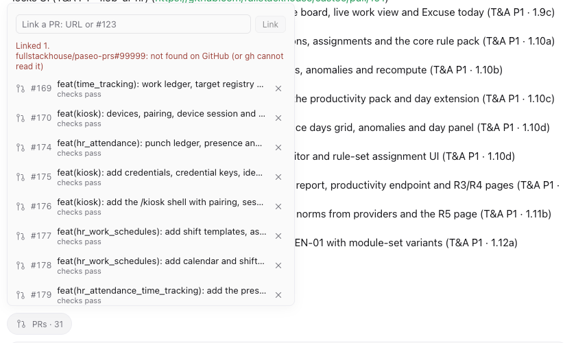
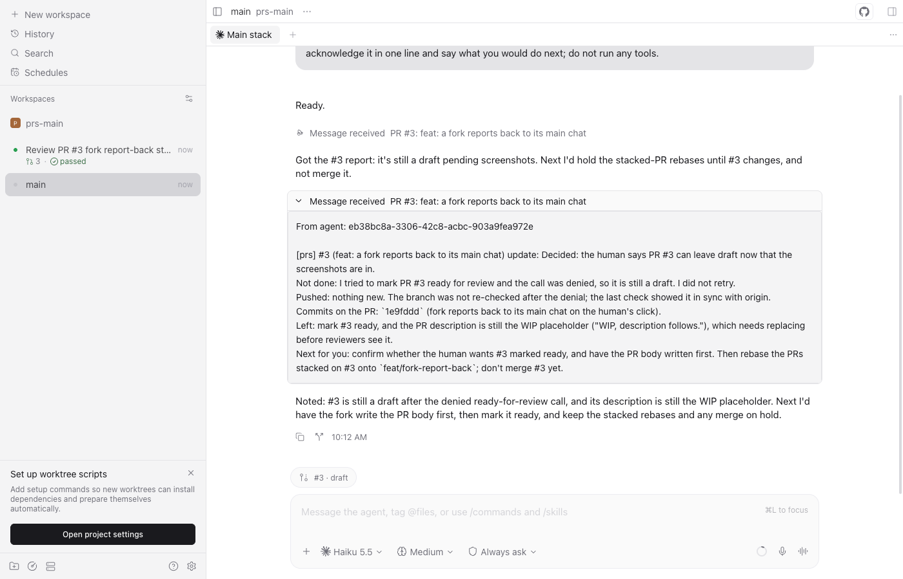

# paseo-prs

A [Paseo](https://paseo.sh) plugin: the pull requests related to a workspace, its branch's PRs plus any you or the agent link, as a pill in each agent's composer (`PRs · 29 · 2 failing`), with a **Create PR** button when there is none, **Fork chat** to continue the conversation in a new workspace on one PR, and **Report to main** in that fork to send the outcome back to the main chat when you are done.





See [OVERVIEW.md](./OVERVIEW.md) for behaviour and limits, [AGENTS.md](./AGENTS.md) for the code.

```bash
npm install && npm run typecheck && npm test
paseo plugin install "$PWD"
```
